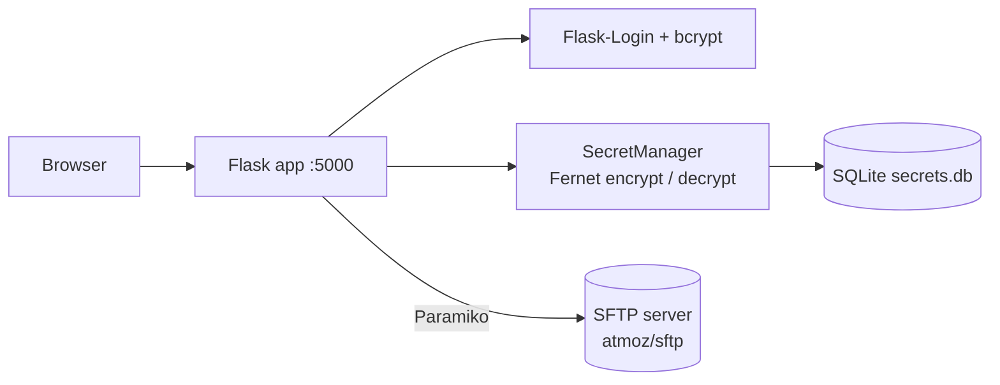
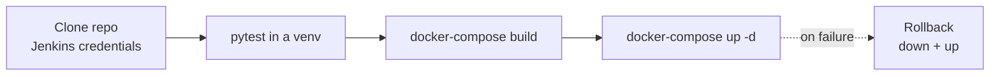

<div align="center">

# 🔐 Flask Secret Vault — with SFTP File Storage and a Jenkins CI/CD Pipeline

**A small web app to store encrypted secrets (Fernet) and exchange files over SFTP, tested with pytest and deployed through Jenkins + Docker Compose.**


</div>

---

##  Overview

A learning project that combines **application security basics** with a **DevOps pipeline**:

- **Accounts** — registration/login with Flask-Login and bcrypt-hashed passwords.
- **Secret vault** — users add, edit, search and delete named secrets; values are encrypted with **Fernet** (symmetric AES-based encryption from `cryptography`) before being saved in SQLite.
- **File exchange** — upload / list / download files on an **SFTP server** (Paramiko) running in a companion container.
- **CI/CD** — a Jenkins pipeline clones, tests, builds and deploys the stack with automatic rollback.

##  Architecture



### Routes

`/` (list + search) · `/add` · `/edit/<id>` · `/delete/<id>` · `/register` · `/login` · `/logout` · `/about` · `/upload` · `/files` · `/download/<filename>` — all vault and file routes require login.

##  CI/CD



##  Tech Stack

| Role | Tools |
|---|---|
| Web | Flask, Flask-Login, Flask-Bcrypt, Flask-SQLAlchemy, Flask-Migrate (Alembic) |
| Crypto & files | `cryptography` (Fernet), Paramiko (SFTP) |
| Data | SQLite |
| Testing | pytest — 9 tests (auth, registration, secret CRUD, search, logout); **all 9 pass** (executed on Python 3.10) |
| DevOps | Docker, Docker Compose, Jenkins |

##  Run

```bash
docker compose up --build        # Flask app → http://localhost:5001, SFTP on port 2223
# or locally
pip install -r requirements.txt && cd app && flask run
pytest                           # run the tests from the repository root
```

Environment variables: `FLASK_SECRET_KEY`, `SFTP_HOST`, `SFTP_PORT`, `SFTP_USER`, `SFTP_PASS`.

>  **Development defaults only.** `docker-compose.yml` ships demo values (`FLASK_SECRET_KEY=supersecretkey`, SFTP `foo / pass123`). Replace them with secrets from your CI/CD or an `.env` file before any real use.

##  Security Review Notes (for a real deployment)

- The Fernet key is stored in a file next to the database (`secret.key`); use a KMS / secret manager and never commit the key or the database.
- Uploaded file names are used in the remote path directly — sanitise with `werkzeug.utils.secure_filename`.
- The image starts the Flask development server (`flask run`, `FLASK_ENV=development`); use Gunicorn behind a reverse proxy with HTTPS.
- Add CSRF protection and rate limiting on login.

##  Housekeeping

The repository contains editor leftovers (`app/tempCodeRunnerFile.py`, `app/test test`, `app/templates/wsgi.py`) that can be removed.

## 👤 Author

**Nour Ghribi** · [GitHub](https://github.com/Nour-Ghribi)
